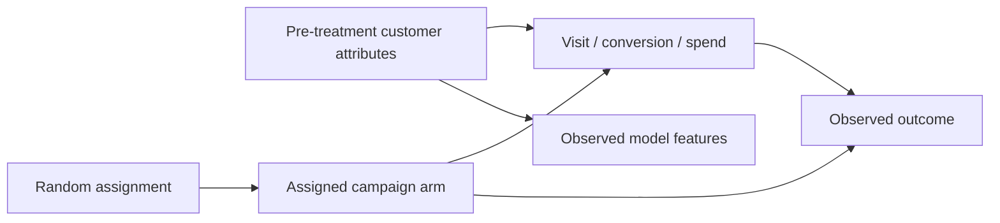

# Causal AI — Customer Growth & Revenue Optimization

A **data-science research project** using the Kevin Hillstrom / MineThatData randomized email experiment. The project moves from randomized experiment analysis to heterogeneous treatment-effect modelling, holdout policy evaluation, and budget-scenario sensitivity analysis.

The deliverable is a **Streamlit research dashboard** plus a dedicated research-analytics page. It is intentionally Python- and statistics-focused: no separate API service or frontend framework is required.

**Decision-maker brief:** [Email experiment decision brief](docs/DECISION_BRIEF.md) — surfaces the positive randomized average effect while keeping the unproven uplift targeting policy separate.

> **Research conclusion:** Email has a positive average effect in this experiment. The current customer-level uplift model has weak outcome prediction (holdout spend R² is close to zero), and its targeting policy has **not demonstrated superiority** to emailing everyone. Individual scores and budget allocations are exploratory analyses, not validated causal effects or production recommendations.

## Research questions

1. What is the average effect of the pooled email treatment on visits, conversion, and spend?
2. How do the two email creatives compare with the no-email control?
3. Can pre-treatment customer attributes predict expected spend under each treatment condition?
4. Does model-based targeting improve on simple policies when evaluated on a randomized holdout?
5. How sensitive is a budget allocation scenario to contact cost and contribution-margin assumptions?

## Dashboard

| Page | Data-science purpose |
|---|---|
| Executive Overview | Cohort profile, randomized-arm outcomes, average treatment effects |
| Customer Intelligence | Pre-treatment covariates and model-implied potential outcomes |
| Experimentation Lab | Two-proportion inference, Welch's t-test, confidence intervals |
| Uplift Intelligence | Two-part T-learner, randomized-holdout IPW policy values, exploratory Qini-style diagnostic |
| Budget Scenario Optimizer | Sensitivity to assumed contact cost, contribution margin, and budget |
| AI Business Reports | Groq-generated executive narrative from aggregate experiment and holdout metrics; Markdown download |
| Research Analytics & Model Validation | Repeated-split uplift comparison, paired bootstrap contrasts, AIPW/CUPED, multiplicity correction, power planning, spend prediction and conformal intervals |

## Dataset

- **Source:** Kevin Hillstrom / MineThatData Email Analytics Challenge (2008).
- **Sample:** 64,000 randomized observations across Mens E-Mail, Womens E-Mail, and No E-Mail.
- **Treatment definition:** the primary analysis pools the two email creatives and compares the observed email mixture with no email.
- **Features:** recency, history segment, historical spend, prior mens/womens purchases, ZIP category, new-customer flag, and channel.
- **Outcomes:** visit, conversion, and spend.

The raw CSV is downloaded on first run to `data/raw/hillstrom.csv`; it is not committed to Git. The dataset has no unique customer identifier. Exact duplicate rows are retained because row equality alone does not establish duplicate customer identity. Review the upstream data terms before redistributing the dataset.

Dataset source description: https://blog.minethatdata.com/2008/03/minethatdata-e-mail-analytics-and-data.html

## Business decision and identification strategy

**Decision question:** For the historical Hillstrom audience, did assignment to either email creative (the pooled email policy) change average visit, conversion, and spend relative to no email—and does a customer-level targeting rule improve spend per eligible customer over emailing everyone?

This is an **observational analysis of a randomized experiment**, not synthetic data and not an observational-treatment study. The upstream experiment assigned customers among two email creatives and a no-email control. The main estimand is therefore the intention-to-treat effect of assignment to the pooled email mixture, not the effect of opening an email or an individual customer's latent response.

### Identification assumptions and causal diagram

The primary difference-in-means estimate relies on the experiment's documented random assignment, consistency of the assigned campaign conditions, no interference between customers, correctly observed outcomes, and treatment positivity. Pooling the two email creatives defines a mixture intervention; it does not identify the effect of either creative in isolation.



The diagram emphasizes that baseline attributes can predict outcomes but should not confound randomized assignment. The assignment mechanism supports exchangeability in expectation; finite-sample balance is assessed with standardized mean differences. The source contains no customer identifier, delivery/open events, or complete operational cost and margin data. The no-interference assumption (for example, household spillovers) cannot be empirically verified. Positivity is supported by non-zero assignment to each of the three arms; for the pooled binary contrast, the empirical treatment share is approximately two thirds.

For an observational deployment dataset, a DAG and an adjustment set would need to be specified before fitting: include only common causes measured before treatment, never adjust for mediators or variables affected by the offer, verify propensity-score overlap, and state that unobserved confounding remains possible. The current randomized dataset cannot quantify hidden-confounder bias in an observational design; that requires a separate observational identification analysis and sensitivity model.

### Baseline versus causal estimate

The observed pooled email-minus-control spend difference is **+$0.5968 per customer** (95% CI +$0.3762 to +$0.8174). Because assignment is randomized, this unadjusted difference-in-means is the design-based ATE estimator—not a misleading observational baseline. A naive correlation comparison would be misleading only if assignment were not randomized or if the analysis departed from the documented assignment mechanism.

### Estimators and scope

The project currently reports:
- Difference-in-means / Welch inference for the randomized ATE.
- A two-part T-learner for exploratory heterogeneous expected-spend predictions.
- IPW policy value and paired policy contrasts on a randomized holdout.

The repository now benchmarks T-, S-, and X-learners, random, recency, and historical-spend rankings on a randomized holdout, with paired bootstrap contrasts and repeated-seed split-sensitivity diagnostics. It also reports a cross-fitted AIPW estimate for the randomized pooled contrast. These methods are not a substitute for a separate observational causal design; matching, hidden-confounding sensitivity analysis, and causal forests are not claimed.

## Statistical design

### Average treatment effects

- Binary outcomes use a two-proportion z-test with a pooled null standard error and an unpooled Wald confidence interval.
- Spend uses Welch's independent two-sample t-test and a Satterthwaite confidence interval.
- The primary estimand is email-mixture minus no-email. Creative-specific comparisons are shown separately to make treatment heterogeneity visible.
- Reported p-values are unadjusted; exploratory subgroup comparisons should not be interpreted as confirmatory tests.

### Heterogeneous treatment-effect model

A two-part T-learner is fitted separately in the pooled-email and no-email groups:

1. Logistic regression estimates conversion probability under each treatment condition.
2. Regularized gradient-boosting regressors estimate positive spend conditional on conversion.
3. Expected spend is estimated as (P(\text{conversion}) \times E(\text{spend}\mid\text{conversion})).
4. Model-implied uplift is expected spend with email minus expected spend without email.

Only pre-treatment covariates are used. Outcomes are not used as model features.

### Holdout policy evaluation

- A stratified 75/25 train/holdout split is used.
- The targeting threshold is selected using training data.
- Policy values are estimated on the randomized holdout using inverse-propensity weighting (IPW), with the known 2/3 pooled-email assignment probability.
- The model policy is compared with emailing everyone and emailing nobody. The paired policy contrast and confidence interval are reported. A seeded permutation diagnostic and baseline standardized-mean-difference balance utility are included in `src/causal_ai/statistics.py`; these are diagnostics, not proof of randomization or absence of confounding.
- Qini/AUUC is presented as an exploratory ranking diagnostic, not as evidence of profitability.

### Budget scenario

The scenario calculation is:

```text
modelled net contribution
  = estimated incremental revenue × assumed contribution margin
    − assumed email contact cost
```

The dataset contains neither delivery costs nor product contribution margins. These inputs are user assumptions. Equal contact costs make the ranking optimal for the stated point estimates, but **do not make the model's causal estimates valid**.

## Evaluation snapshot

The reproducible analysis is documented in [the full evaluation report](reports/full_evaluation.md). Model purpose, intended use, evaluation, and limitations are summarized in the [model card](reports/model_card.md) and the [identification and limitations note](reports/IDENTIFICATION_AND_LIMITATIONS.md).

| Holdout policy | IPW estimated spend per customer |
|---|---:|
| Model policy | $1.127 |
| Email everyone | $1.310 |
| Email nobody | $0.671 |

The paired model-policy minus email-everyone estimate is **−$0.183 per customer** (95% CI: −$0.444 to +$0.077). The interval includes zero. This experiment does not establish that the model policy is better or worse than emailing everyone.

Holdout spend R² is approximately 0.002 for control and 0.0002 for treatment. The model explains very little individual spend variation. Customer-level uplift scores must therefore remain exploratory.

## Reproducibility and setup

Python 3.10+ (Python 3.12 recommended).

```bash
python -m venv .venv

# Windows PowerShell
.venv\Scripts\Activate.ps1

# macOS / Linux / WSL
source .venv/bin/activate

pip install -r requirements.txt
python scripts/run_pipeline.py
streamlit run app.py
```

On first launch, the app downloads the dataset if it is not present. Run the modelling pipeline once to generate `artifacts/uplift_model.joblib` and evaluation metrics. Streamlit Community Cloud can run the pipeline from the dashboard using **Train causal models now** when artifacts are absent.

## Groq-powered AI Business Reports

The **AI Business Reports** page uses Groq Chat Completions to turn verified aggregate experiment results into an executive Markdown report. Python remains the source of truth; Groq writes the narrative only. The request includes aggregate treatment effects, confidence intervals, p-values, holdout policy values, and model diagnostics. It does **not** send raw customer rows or customer-level scores.

Add the following in Streamlit Community Cloud → **App settings → Secrets** (never commit a real key):

```toml
GROQ_API_KEY = "your_groq_api_key"
# Optional model override
GROQ_MODEL = "openai/gpt-oss-120b"
```

The report can be downloaded as Markdown. Interactive conversion, spend, and holdout-policy charts are rendered separately from verified Python aggregates; the LLM does not generate or invent chart values. Generated text is decision support, not a replacement for checking the statistical results. See the [Groq quickstart](https://console.groq.com/docs/quickstart) and [text generation documentation](https://console.groq.com/docs/text-chat).

## Deploy the dashboard

The project is designed for **Streamlit Community Cloud**; no separate backend service is required.

1. Push the repository to GitHub.
2. Create an app at https://share.streamlit.io/.
3. Select this repository, the `main` branch, and `app.py` as the main file.
4. Deploy. The runtime installs only the packages in `requirements.txt`.
5. Before the first app launch, open GitHub → **Actions** → **Train and persist uplift model** → **Run workflow**. This one-time manual workflow downloads the public Hillstrom dataset, trains the model in Python 3.12, and commits the reusable model, evaluation metrics, and training manifest to `artifacts/`.
6. Streamlit loads the saved `artifacts/uplift_model.joblib` and `artifacts/metrics.json` at runtime. **The dashboard never trains the model.** Retrain only when you intentionally change the model, features, data, or training procedure; run the workflow again to replace the saved artifacts.

The raw dataset remains downloaded at runtime rather than committed. The serialized model and metrics are versioned in GitHub, so Streamlit restarts do not require model retraining. The scikit-learn version is pinned to keep the training and serving environments compatible.

To refresh the model intentionally, rerun the **Train and persist uplift model** workflow from the Actions tab. It also writes `artifacts/model_manifest.json` with the training timestamp, source commit, package versions, and SHA-256 checksums for the dataset and model.

## Streamlit Community Cloud availability

Community Cloud currently hibernates apps after 12 hours without traffic (not 30 minutes). The **Keep Streamlit demo warm** GitHub Actions workflow opens the public app in a headless browser every 4 hours and clicks the app's wake-up control if the hibernation page appears. This is best-effort only: GitHub scheduled workflows can be delayed or skipped during periods of high load, and this does not provide an uptime guarantee. Scheduled workflows run from the default branch; GitHub may automatically disable scheduled workflows in public repositories after 60 days without repository activity.

## Tests and quality checks

```bash
pip install -r requirements-dev.txt
pytest -q
python -m compileall -q app.py src scripts tests
```

Runtime dependencies stay in `requirements.txt`; test tooling is isolated in `requirements-dev.txt`. GitHub Actions installs the development requirements, compiles the Python modules, runs the automated unit tests, and checks dependency consistency. The full 64,000-row model pipeline is kept out of CI to keep checks fast and deterministic.

## Repository structure

```text
app.py                       Streamlit research dashboard
src/causal_ai/data.py        Dataset loading and validation
src/causal_ai/statistics.py  A/B test estimators and inference
src/causal_ai/modeling.py    T-learner, diagnostics, IPW evaluation
src/causal_ai/benchmarking.py Meta-learners, ranking baselines, bootstrap, 3-arm analysis
src/causal_ai/optimization.py
                             Budget scenario arithmetic
src/causal_ai/pipeline.py    Reproducible analysis pipeline
scripts/run_pipeline.py     One-command model training
scripts/run_uplift_benchmark.py
                             Meta-learner and creative benchmark runner
reports/                     Evaluation report and data profile
tests/                       Statistical and modelling tests
configs/                      Reproducible analysis assumptions
```

## Assumptions, interpretation and limitations

- Treatment is the assigned email mixture (intention-to-treat), not email opening or engagement.
- Consistency and no interference are assumed; household or social spillovers are not measured.
- Assignment probabilities are known from the 1:1:1 three-arm design; the pooled email probability is 2/3 and control is 1/3.
- The pooled contrast has positivity because both assignment groups are represented. The observational propensity-overlap condition is not applicable to this randomized design; it must be checked separately for any non-randomized extension.
- Baseline balance is a diagnostic, not proof of randomization. Imbalance can occur by chance.
- No unmeasured-confounding sensitivity claim is made: randomization is the identification basis here. For observational extensions, unmeasured confounding remains an explicit threat.
- Do not adjust for post-assignment mediators such as email opens, clicks, visits, or conversion when estimating the total assignment effect.
- Customer-level CATE predictions are not individually identifiable; the T-learner approximates conditional response differences and has weak spend prediction.
- The optimizer uses assumed contact cost and contribution margin; its outputs are scenarios, not realized ROI.

## Why the average treatment effect can be positive while uplift targeting is weak

These are different statistical questions.

**The average treatment effect (ATE)** compares mean outcomes under the randomized email mixture and no-email control. Random assignment makes the difference in group means a design-based estimate of the average effect for this experiment, subject to the documented assignment, consistency, outcome-measurement and no-interference assumptions. The observed pooled spend difference is +$0.5968 per assigned customer (95% CI +$0.3762 to +$0.8174).

**Individualized uplift ranking** asks a harder question: can pre-treatment characteristics reliably distinguish which customers benefit more from email? The individual treatment effect for a person is never observed because that person receives only one assignment. A T-learner approximates conditional mean outcomes by fitting separate response models in the two assignment groups, then subtracts the predictions. Noise in either model is carried into the difference; sparse conversions and highly zero-inflated spend make that especially difficult.

Therefore, a positive ATE does not imply that a targeting model can identify the best recipients. Emailing everyone can be beneficial on average even when the model cannot rank heterogeneous effects accurately. In this evaluation the model-policy IPW estimate is about $1.127 per customer, compared with $1.310 for emailing everyone. The paired model-minus-email-everyone estimate is −$0.183 (95% CI −$0.444 to +$0.077), so superiority has not been demonstrated.

**Decision implication:** the experiment supports an average email effect for this historical audience; it does not support deploying the current customer-level scores or claiming that targeted allocation increases profit.

## Repeated-split robustness diagnostic

The repository now includes an optional repeated-split evaluation. It refits the same two-part T-learner across multiple seeded stratified partitions and reports split-to-split variation in model-policy value, email-everyone and email-nobody policy values, model-minus-email-everyone contrasts, targeting share, and exploratory Qini/AUUC diagnostics.

Run after downloading the raw dataset:

```bash
python scripts/run_robustness.py
```

Optional controls:

```bash
python scripts/run_robustness.py --seeds 11,23,37,51,73 --test-size 0.25 --threshold 0.05
```

The output is written to `reports/repeated_split_robustness.json`. These are repeated partitions of the **same 64,000-row historical dataset**, not independent replications or external validation. The repeated-split report is a sensitivity diagnostic; it must not be used to choose a final model and then be described as an untouched confirmation. The primary evidence remains the frozen evaluation in [reports/full_evaluation.md](reports/full_evaluation.md).

## Research CLI: uplift meta-learner and multi-treatment benchmark

Run the expanded benchmark after the raw Hillstrom CSV is available:

```bash
python scripts/run_uplift_benchmark.py
```

Optional controls:

```bash
python scripts/run_uplift_benchmark.py --seed 42 --test-size 0.25 --bootstrap 1000
```

The full machine-readable report is written to `reports/uplift_benchmark.json`. To run it without consuming the Streamlit instance, open GitHub → **Actions** → **Uplift Meta-Learner Benchmark** → **Run workflow**. Choose a seed and bootstrap count; the JSON report is uploaded as the `hillstrom-uplift-benchmark` workflow artifact for 30 days. The benchmark uses one stratified train/holdout partition of the same randomized experiment and compares:

| Strategy | Definition |
|---|---|
| T-learner | Separate ExtraTrees expected-spend outcome models for pooled email and control; predict the difference |
| S-learner | One expected-spend model with treatment as an input; predict each customer under both assignments |
| X-learner | Impute effects from the two outcome models, fit arm-specific effect models, and combine using known propensity |
| Random | Seeded random ranking |
| Recency | Rank lower recency values first (more recent purchase) |
| Historical spend | Rank higher pre-treatment historical spend first |

All ranking strategies target the same approximate 2/3 contact share, matching the pooled email assignment share. Policy value is estimated on the untouched holdout using the Horvitz-Thompson inverse-propensity-weighted estimator:

```text
V(policy) = mean[ I(A = policy(X)) * Y / P(A = policy(X)) ]
```

**Qini and AUUC definitions:** for each ranking, construct the Horvitz-Thompson pseudo-outcome `A*Y/e - (1-A)*Y/(1-e)`, sort customers by predicted score, and cumulatively sum the pseudo-outcome. AUUC is the trapezoidal area under that cumulative gain curve. Qini is the area between that curve and the straight-line gain expected from random ranking. These are ranking diagnostics, not profit estimates, CATE calibration scores, or proof of policy superiority. The random-ranking comparator is one seeded realization; repeat the seed to characterize its Monte Carlo variation.

**Bootstrap uncertainty:** policy contrasts use paired nonparametric resampling of holdout rows and percentile 95% intervals. The report includes each strategy versus emailing everyone and pairwise contrasts between the ranking strategies (including T-vs-S, T-vs-X, and learner-vs-baseline comparisons). The intervals condition on fitted models and do not include uncertainty from training, model selection, or repeated dataset collection. They should not be interpreted as a prospective deployment guarantee.

### Repeated-seed stability and model diagnostics

The research workflow also runs the expanded benchmark over five stratified splits:

```bash
python scripts/run_repeated_seed_diagnostics.py \
  --seeds 21,42,63,84,105 --bootstrap 100
```

This writes:

- `reports/repeated_seed_benchmark.json`: per-seed results, cross-seed means/standard deviations/ranges, winner counts, feature-importance summaries, score quantiles, and per-seed diagnostics.
- `reports/repeated_seed_diagnostics.html`: interactive charts for policy-value stability, cumulative HT gain and its random-ranking reference, AUUC, Qini, seed-42 bootstrap policy contrasts, ExtraTrees feature importance, uplift-score histograms, and HT pseudo-outcome by predicted-uplift decile.

The workflow retains the single-seed `reports/uplift_benchmark.json` run (seed 42 and 1,000 bootstrap replicates by default) and adds the five-seed diagnostics (100 bootstrap replicates per split by default). The five seeds are repeated partitions of the same 64,000-row historical experiment—not five independent randomized experiments. Cross-seed standard deviations describe sensitivity to the split and should not be presented as confidence intervals for future deployment.

**Model interpretation safeguards:** feature importance is ExtraTrees impurity importance aggregated back to original features. It is predictive importance, not a causal explanation. Uplift-score histograms describe model-implied expected-spend differences. Decile summaries compare predicted ranking with holdout Horvitz-Thompson pseudo-outcomes, which are noisy and do not establish individual treatment-effect calibration. Historical-spend ranking may perform well because history predicts outcome level; that does not mean it predicts incremental treatment benefit.

### Three-arm creative analysis

The multi-treatment extension preserves the randomized `No E-Mail`, `Mens E-Mail`, and `Womens E-Mail` arms. It reports observed spend differences with Welch confidence intervals for:

- Mens E-Mail versus No E-Mail.
- Womens E-Mail versus No E-Mail.
- Mens E-Mail versus Womens E-Mail.

A separate three-arm outcome-model T-learner predicts expected spend under each creative and calculates model-implied pairwise effects. Creative-specific targeting policies are evaluated against control within each two-arm subset, using the known 1/2 conditional assignment probability and a 50% contact share.

The observed arm-level contrasts are randomized average effects. The model-implied customer-level contrasts are exploratory and are not individually observed. The benchmark does not claim that one creative is universally optimal or that the targeting policies are profitable.

## Limitations and next research steps

- Estimate creative-specific treatment effects rather than relying only on a pooled treatment.
- Repeat the train/holdout evaluation across random seeds and report uncertainty across splits.
- Compare uplift ranking with random, recency-based, and history-based baselines.
- Evaluate subgroup calibration and policy-value stability.
- Conduct a new randomized policy experiment before using customer-level targeting operationally.
- Add pre-specified sensitivity analyses and multiplicity control for confirmatory subgroup work.

## Scope

This repository is an educational and analytical research project. It is not a live marketing automation system, a causal-effect oracle, or a validated profit forecasting product.


---

# Read this to understand and explain the project

This section is written as a learning guide. Read it from top to bottom to understand the business problem, the experiment, the models, the evaluation design, and the limits of the conclusions. It also gives you a concise interview explanation at the end.

## 1. The project in one sentence

I built a research-oriented customer growth platform that analyzes a randomized email-marketing experiment, estimates the average effect of email, tests whether machine-learning models can identify customers with different treatment responses, evaluates targeting policies on randomized holdout data, and reports uncertainty through statistical inference and prediction intervals.

The important distinction is that this project does not simply predict who will spend more. It investigates whether sending an email changes expected spend, for whom the change might be larger, and whether acting on model rankings would improve a marketing decision.

## 2. The business problem

A marketing team has a limited contact budget. It can:

- Send an email to everyone.
- Send an email to nobody.
- Send an email to a selected share of customers.
- Choose between two email creatives.

A conventional response model estimates who is likely to purchase or spend. That can be useful for finding high-value customers, but it does not necessarily identify customers whose behaviour will change because of the email.

For example:

- Customer A may spend a lot whether or not an email is sent.
- Customer B may spend little without an email but may be persuaded by one.
- A response model may rank Customer A first because their expected spend is high.
- An uplift model tries to rank customers by the *difference* between their expected outcome with treatment and without treatment.

The decision question is therefore:

**Can customer information help us decide whom to email, and does that targeting policy perform better than a simple policy such as emailing everyone?**

The project deliberately evaluates this question rather than assuming that a more complex model is automatically better.

## 3. Dataset and experiment design

The project uses the Kevin Hillstrom / MineThatData Email Analytics Challenge dataset from 2008. It contains approximately 64,000 observations assigned to three randomized groups:

| Original arm | Meaning |
|---|---|
| No E-Mail | Control group; no campaign email |
| Mens E-Mail | Customers assigned the men's email creative |
| Womens E-Mail | Customers assigned the women's email creative |

The original allocation is approximately one third to each arm. For the main pooled analysis, the two email groups are combined:

- Treatment = Mens E-Mail or Womens E-Mail.
- Control = No E-Mail.
- Pooled treatment probability = 2/3.
- Control probability = 1/3.

Pooling estimates the average effect of the *mixture of the two email creatives*. It does not estimate the effect of either creative individually. The project also retains a separate three-arm analysis so that the creative comparisons are not lost.

### What information is available?

The pre-treatment customer attributes include:

- Recency: time since the customer's previous purchase.
- History: historical customer spend.
- History segment: a categorical representation of historical spend.
- Mens and Womens: indicators of previous purchases in those categories.
- ZIP code category.
- New-customer indicator.
- Acquisition channel.

The outcomes include:

- Visit: whether the customer visited.
- Conversion: whether the customer purchased.
- Spend: observed spend in the experiment.

The model feature set is restricted to pre-treatment attributes. Treatment assignment and post-treatment outcomes are not used as customer predictors. This avoids using information that would only become available after the campaign and prevents a major form of target leakage.

The source does not provide a unique customer identifier, email-open events, delivery costs, contribution margins, or a time series of repeated customer outcomes. Exact duplicate rows are retained because identical values do not prove that two rows represent the same customer.

## 4. Why randomization matters: the causal question

Because campaign assignment was randomized, the treatment and control groups can be compared to estimate the average causal effect of assignment, subject to the experiment's assumptions.

The main estimand is the intention-to-treat (ITT) effect:

```
ATE = E[Y | assigned email] - E[Y | assigned no email]
```

Here, Y can be visit, conversion, or spend. The estimate concerns assignment to an email campaign, not whether a customer opened or read the email.

Randomization is important because customer characteristics such as historical spend may influence future spend. In an ordinary observational dataset, customers selected for an email could differ systematically from customers not selected. In a randomized experiment, assignment is independent of baseline characteristics in expectation, so a difference in average outcomes can be attributed to assignment under the design assumptions.

### Assumptions to understand

1. **Random assignment:** the original assignment mechanism was followed.
2. **Consistency:** the assigned treatment corresponds to the campaign condition being studied.
3. **No interference:** one customer's assignment does not change another customer's outcome. Household or social spillovers are not measured here.
4. **Positivity:** each relevant treatment condition has a non-zero probability of assignment.
5. **Outcome measurement:** outcomes are measured consistently across arms.

The project inspects baseline balance using standardized mean differences (SMDs). Balance is a useful diagnostic, but it does not prove that randomization was performed correctly.

## 5. The first analysis: average treatment effects

Before building machine-learning models, the project establishes what happened on average.

### Binary outcomes: visit and conversion

For visit and conversion, the project uses a two-proportion z-test.

It compares the treatment and control rates, calculates the difference in proportions, and reports a p-value and confidence interval. The z-test uses a pooled standard error under the null hypothesis of equal proportions; the reported Wald confidence interval uses an unpooled standard error.

A conversion-rate difference is best described in percentage points. For example, a change from 5% to 6% is an increase of one percentage point, not one percent.

### Continuous outcome: spend

For spend, the project uses Welch's independent two-sample t-test. Welch's method does not assume equal population variances. The confidence interval uses the Satterthwaite approximation for degrees of freedom.

The current documented full-sample pooled spend estimate is approximately +$0.5968 per assigned customer, with a 95% confidence interval from +$0.3762 to +$0.8174. Treat this as the historical experiment's average spend effect, not as profit: the dataset does not contain campaign costs or contribution margins.

### Multiple comparisons

The advanced statistics workflow also applies the Holm step-down correction to the three pooled outcome tests (visit, conversion, and spend). This controls the family-wise error rate for that specified family of tests. It does not automatically correct every exploratory subgroup or creative comparison in the application.

## 6. Why ordinary prediction is not enough

A standard prediction model estimates an outcome such as:

```
Expected spend = f(customer characteristics)
```

This can rank customers by likely spend. However, a high-spending customer may spend heavily even without an email. If the goal is to decide who should receive an email, the more relevant quantity is the incremental effect of treatment.

For customer characteristics X, the conditional average treatment effect (CATE) is:

```
CATE(X) = E[Y(1) | X] - E[Y(0) | X]
```

- Y(1) is the potential outcome if the customer is assigned an email.
- Y(0) is the potential outcome if the customer is assigned no email.
- Only one of these outcomes is observed for each customer.

That last point is fundamental: we never observe both potential outcomes for the same person. A model can estimate conditional averages for groups with similar characteristics, but it cannot reveal an individual's true personal treatment effect.

## 7. Uplift modelling: T-, S- and X-learners

The benchmark compares three meta-learning approaches. All use pre-treatment customer features and are evaluated on the same stratified train/holdout split for a given seed.

### T-learner

The T-learner fits two separate outcome models:

1. Fit one model using customers assigned to control.
2. Fit another model using customers assigned to email.
3. Predict both potential outcomes for every holdout customer.
4. Subtract the control prediction from the email prediction.

```
Uplift_T(X) = model_email(X) - model_control(X)
```

In the benchmark implementation, these outcome models are ExtraTrees regressors. The original dashboard's two-part T-learner is a separate implementation: it models conversion probability with logistic regression and positive spend conditional on conversion with gradient boosting, then multiplies the two predictions to estimate expected spend.

### S-learner

The S-learner fits one outcome model and includes treatment assignment as an input feature.

For every holdout customer, it predicts twice:

- Once with treatment set to 0.
- Once with treatment set to 1.

The difference between those two predictions is the S-learner's model-implied uplift.

### X-learner

The X-learner first estimates outcomes in each treatment arm, then imputes treatment effects for treated and control observations. It fits models to those imputed effects and combines the two estimates using the known treatment propensity.

The benchmark uses the pooled treatment propensity of 2/3 in this combination.

### Why compare multiple learners?

There is no universally best meta-learner. Their behaviour depends on sample size, treatment allocation, outcome noise, and how treatment-effect heterogeneity is represented. Comparing them with simple ranking baselines helps reveal whether the model is learning useful treatment-response information or merely rediscovering who is already valuable.

The benchmark also includes:

- Seeded random ranking.
- Recency ranking (more recent customers first).
- Historical-spend ranking (higher historical spend first).

Every ranking strategy is evaluated at the same targeting budget: approximately two thirds of the holdout, matching the pooled email allocation.

## 8. How the randomized holdout evaluates a targeting policy

A model score is not enough to prove that a targeting strategy works. The project therefore separates model fitting from policy evaluation.

1. Split the data into a training partition and a holdout partition, stratified by original experiment arm.
2. Fit the uplift models using training data only.
3. Use model scores to rank holdout customers.
4. Select the top share allowed by the contact budget.
5. Evaluate the resulting fixed policy using the randomized assignments and observed outcomes in the holdout.

### Inverse-propensity weighting (IPW)

The pooled experiment assigned email with probability e = 2/3 and control with probability 1-e = 1/3.

For a policy that assigns action pi(X), the IPW contribution for a holdout observation is:

```
I(A = pi(X)) * Y / P(A = pi(X))
```

The estimated policy value is the average of those contributions over holdout observations.

In plain English: a customer's outcome contributes to the policy evaluation when the action they were actually randomized to receive matches the action the policy would have chosen. The contribution is weighted by the inverse probability of receiving that action under the experiment.

This allows us to estimate how a fixed targeting rule would have performed using randomized experimental data, without pretending that we observed both outcomes for every customer.

### Policy comparisons

The benchmark compares the learned policies with:

- Email everyone.
- Email nobody.
- Random ranking.
- Recency ranking.
- Historical-spend ranking.
- Other meta-learners.

Paired policy contrasts use the same holdout rows for both policies. This makes the comparison more direct than comparing two unrelated samples.

## 9. AUUC and Qini: what the ranking curves mean

The benchmark also calculates cumulative uplift-gain curves using the Horvitz–Thompson pseudo-outcome:

```
A*Y/e - (1-A)*Y/(1-e)
```

The holdout customers are sorted by predicted uplift. The pseudo-outcomes are accumulated as we move down the ranking.

- **AUUC:** trapezoidal area under the cumulative gain curve.
- **Qini:** area between the model's cumulative gain curve and the straight-line random-ranking reference.

These metrics assess ranking behaviour in the randomized holdout. They are exploratory diagnostics. They are not profit, not a direct measure of individual CATE calibration, and not proof that a policy beats emailing everyone. A ranking can have an attractive curve and still fail to deliver a statistically supported policy-value improvement at the chosen budget.

Historical spend is an especially important baseline. It may rank customers with high outcome levels very well, even if it does not identify customers whose outcomes are changed most by email.

## 10. Uncertainty around policy comparisons

The benchmark uses a paired nonparametric bootstrap over holdout rows:

1. Resample holdout row indices with replacement.
2. Recalculate the policy-value difference for the two policies on that resample.
3. Repeat the process.
4. Use the 2.5th and 97.5th percentiles as a percentile 95% interval.

This interval describes uncertainty in the holdout policy contrast, conditional on the models and policies that were already fitted. It does **not** include uncertainty from refitting the models, choosing hyperparameters, selecting a model, or collecting a new experiment.

A confidence interval that crosses zero means the evaluation has not established a difference at the corresponding confidence level. It does not prove that the policies are exactly equal.

## 11. Repeated-seed robustness

A single train/holdout split can be unusually favourable or unfavourable. The repeated-seed workflow reruns the benchmark on five stratified partitions using seeds:

```
21, 42, 63, 84, 105
```

It summarizes the mean, standard deviation, minimum, maximum, and winner counts for policy value, AUUC, and Qini. It also generates diagnostics such as:

- Policy-value stability across splits.
- Cumulative Horvitz–Thompson gain curves.
- Uplift-score distributions.
- Predicted-uplift deciles compared with holdout pseudo-outcomes.
- Feature-importance summaries.

The five seeds are not five independent experiments. They are different partitions of the same historical 64,000-row dataset. The standard deviation is therefore a measure of split sensitivity, not a confidence interval or independent replication.

The previous five-seed snapshot showed the S-learner leading the mean policy-value, AUUC, and Qini summaries. That is a descriptive benchmark result, not proof of deployment superiority. The project still requires the paired holdout policy contrast to support any claim that a learned policy is better than emailing everyone.

## 12. Separate spend-prediction task and conformal intervals

The research extension adds a separate spend-prediction experiment. This is deliberately not called time-series forecasting.

Hillstrom is a one-period experiment. It does not provide repeated customer observations over a dated sequence. There is no temporal target horizon to forecast and no valid chronological backtest to run. The task is instead:

**Can pre-treatment customer characteristics predict spend in this one-period experiment?**

### Model

The implementation uses a HistGradientBoostingRegressor with:

- Median imputation for numeric features.
- Most-frequent imputation for categorical features.
- One-hot encoding for categorical features.
- Pre-treatment features only.

The dataset is split into three disjoint partitions:

| Partition | Share | Purpose |
|---|---:|---|
| Training | 60% | Fit the prediction model |
| Calibration | 20% | Estimate the conformal residual threshold |
| Test | 20% | Evaluate predictive performance and interval coverage |

The split is reproducible with a fixed random seed and is stratified by treatment and whether spend is positive.

### Prediction metrics

- **MAE:** average absolute prediction error; lower is better.
- **RMSE:** square root of mean squared error; penalizes large errors more heavily.
- **R²:** proportion of test-set outcome variation explained relative to predicting the test mean; it can be negative.
- **Mean baseline:** predicts the training-set average spend for every test observation.

The model must be compared with the baseline. A model is not useful merely because it has been trained or because it uses a more sophisticated algorithm.

### Split-conformal prediction intervals

After training, the model predicts spend for the calibration partition. The absolute residuals are:

```
residual_i = |actual_spend_i - predicted_spend_i|
```

The implementation takes the finite-sample higher quantile corresponding to the requested miscoverage level. With alpha = 0.10, the nominal marginal coverage target is 90%.

For each test prediction, the interval is formed using the same calibration radius:

```
lower = max(0, prediction - radius)
upper = prediction + radius
```

The dashboard reports empirical test coverage and mean interval width. Coverage should be compared with the nominal 90% target. A wide interval may achieve coverage but provide limited decision value.

The theoretical split-conformal guarantee relies on exchangeability between calibration and test observations. It is a marginal guarantee under that assumption, not a promise that every customer subgroup has 90% coverage. The report also breaks coverage and prediction metrics out by randomized arm as a diagnostic.

Permutation importance measures how much holdout MAE worsens when a feature is shuffled. It describes predictive reliance in this fitted model; it is not a causal explanation.

## 13. Advanced statistical analysis

The advanced statistics workflow brings several complementary checks together.

### Cross-fitted AIPW

Augmented inverse-probability weighting combines an outcome-regression estimate with an inverse-propensity correction. Its influence-function form is:

```
mu1(X) - mu0(X)
+ A*(Y - mu1(X))/e
- (1-A)*(Y - mu0(X))/(1-e)
```

The project uses five-fold stratified cross-fitting to generate out-of-fold outcome predictions under both actions. The randomized assignment propensity is known and set to 2/3.

The AIPW estimate is the mean of these adjusted contributions. Its standard error is calculated from the sample standard deviation of the influence-function values divided by the square root of the sample size.

AIPW is called doubly robust because, under the standard identification conditions, consistency can hold if either the propensity model or both outcome models are correctly specified. Here the propensity comes from the randomized design. Cross-fitting helps reduce overfitting bias in the nuisance predictions; it does not make a misspecified outcome model perfect.

### CUPED

CUPED is a variance-reduction technique that uses a pre-treatment covariate correlated with the outcome. This project uses historical spend as the baseline covariate.

The adjusted outcome has the form:

```
adjusted Y = Y - theta * (historical spend - mean historical spend)
```

The workflow reports the adjusted treatment effect and the change in standard error relative to the unadjusted estimate. CUPED aims to improve precision; it does not change the randomized assignment or fix a flawed experiment.

### Holm correction

The workflow applies Holm correction to the three primary pooled outcome p-values: visit, conversion, and spend. This reduces the chance of false positives when testing this defined family of hypotheses.

### Power planning

The power calculation estimates the sample size needed for a future two-proportion conversion experiment, using:

- The observed control conversion rate as the planning baseline.
- A user-specified absolute minimum detectable effect.
- A 5% significance level.
- 80% statistical power.

It is a planning approximation, not a claim that the current experiment was designed for that exact effect.

### Baseline balance

The workflow calculates standardized mean differences for numeric features and one-hot categorical levels between the pooled email and control groups. This is a descriptive balance audit. Small SMDs are reassuring but cannot prove the randomization process or the absence of every source of bias.

## 14. Three-arm creative analysis

Pooling the two email creatives is useful for the primary email-versus-control question, but it hides possible differences between the campaigns. The benchmark therefore preserves all three original arms and reports:

- Mens E-Mail versus No E-Mail.
- Womens E-Mail versus No E-Mail.
- Mens E-Mail versus Womens E-Mail.

Observed differences are estimated from randomized arm outcomes with Welch confidence intervals. These are average arm effects.

The benchmark also fits separate outcome models for the three arms and calculates model-implied customer-level pairwise differences. Those customer-level predictions are exploratory: they are not individually observed causal effects.

For creative-specific targeting, the benchmark restricts the comparison to one creative and control, where the conditional assignment probability is 1/2, and evaluates a 50% contact policy. These results should not be confused with the pooled two-thirds-budget policy.

## 15. Budget scenario: translate estimates into assumptions

The dashboard includes a scenario calculator:

```
Modelled net contribution
  = estimated incremental revenue * assumed contribution margin
    - assumed email contact cost
```

The user supplies contact cost and contribution margin because neither is included in the dataset.

This is a sensitivity analysis, not measured profit or realized ROI. If the uplift model is weak, the scenario inherits that weakness. Changing the margin or cost assumptions can change the scenario output, but it cannot make the underlying causal estimate more reliable.

## 16. AI-generated business report: where Groq fits

The AI Business Reports page uses Groq to turn aggregate statistical results into an executive-style written summary.

The division of responsibility is intentional:

- Python calculates the estimates, metrics, confidence intervals, and chart data.
- Groq generates explanatory prose from the aggregate results.
- Charts are rendered from the Python outputs, not invented by the language model.
- Raw customer rows and customer-level scores are not sent as the report context.

The language model is a reporting layer, not the statistical engine. Its narrative should always be checked against the numeric report before being used in a business decision.

## 17. How the project runs

There are two main workflows.

### Interactive dashboard

The Streamlit application loads the Hillstrom data, validates it, and presents the exploratory analysis, statistical tests, experiment evidence, uplift diagnostics, budget assumptions, and AI-generated reporting.

Run locally:

```bash
python -m venv .venv

# Windows PowerShell
.venv\\Scripts\\Activate.ps1

# macOS / Linux / WSL
source .venv/bin/activate

pip install -r requirements.txt
python scripts/run_pipeline.py
streamlit run app.py
```

### Reproducible research benchmark

The expanded research workflow is manually triggered through GitHub Actions. It runs the uplift benchmark, repeated-seed diagnostics, independent spend prediction, advanced statistics, and summary generation. It publishes JSON snapshots for the research analytics page and uploads a downloadable artifact bundle.

Run the equivalent commands locally after the raw dataset is available:

```bash
python scripts/run_uplift_benchmark.py --seed 42 --bootstrap 1000
python scripts/run_repeated_seed_diagnostics.py --seeds 21,42,63,84,105 --bootstrap 100
python scripts/run_spend_prediction.py --seed 42 --alpha 0.10
python scripts/run_advanced_statistics.py --seed 42 --folds 5 --mde 0.005
python scripts/build_research_summary.py
```

The workflow's generated reports include:

| Output | What it contains |
|---|---|
| `reports/uplift_benchmark.json` | Primary-seed learner, baseline, policy, bootstrap, and creative comparisons |
| `reports/repeated_seed_benchmark.json` | Per-seed and across-seed policy and ranking diagnostics |
| `reports/repeated_seed_diagnostics.html` | Interactive diagnostic charts |
| `reports/spend_prediction.json` | Prediction metrics, baseline comparison, conformal coverage, arm metrics, permutation importance |
| `reports/advanced_statistics.json` | AIPW, CUPED, Holm-adjusted tests, balance, and power planning |
| `reports/research_summary.json` | Compact dashboard-ready research summary |
| `artifacts/spend_forecaster.joblib` | Fitted spend-prediction pipeline |

The research benchmark workflow is separate from the dashboard's model-training workflow. They produce different artifacts for different purposes. A successful CI test run does not mean that the full research workflow has run or that the latest research reports have been generated.

## 18. How to read the results without overclaiming

Use this order when reviewing a fresh run:

1. **Check the run completed.** Confirm the GitHub Actions workflow succeeded and all expected reports were generated.
2. **Check the prediction baseline.** Compare model MAE and RMSE with the mean baseline. Inspect R² rather than assuming it must be positive.
3. **Check conformal coverage.** Compare empirical test coverage with the 90% nominal target and inspect interval width. Review arm-specific coverage.
4. **Check the causal estimate.** Compare the unadjusted, CUPED, and AIPW estimates and their intervals. Understand why they differ, if they do.
5. **Check uplift policy value.** Compare each policy with emailing everyone using the paired holdout contrast and interval.
6. **Check repeated-split stability.** See whether rankings and policy values change substantially across partitions.
7. **Check creative comparisons.** Keep observed randomized-arm effects separate from model-implied customer effects.
8. **Only then write the conclusion.** State what is supported, what is uncertain, and what should be tested next.

Do not copy old metrics into a new evaluation summary without checking the current generated report. The previous published snapshot is a historical reference, not a substitute for rerunning the workflow.

### Current evidence-based interpretation

The existing evaluation documents a positive average email effect on spend in this historical randomized experiment. However, the customer-level spend models have very low holdout R², and the previously reported model targeting policy did not demonstrate superiority to emailing everyone: its estimated policy value was lower, and the paired confidence interval included zero.

The repeated-seed benchmark previously showed the S-learner leading the mean ranking and policy-value summaries, but repeated partitions of one dataset are not independent replications. The correct conclusion is that the S-learner is a candidate worth investigating—not that it is a proven production policy.

The new spend-prediction and advanced-statistics reports must be generated and inspected before quoting their latest metrics. Until then, do not claim that the prediction model beats its baseline or that conformal intervals achieve their nominal coverage.

## 19. Interview-ready project explanation

### 30-second version

"I built a customer growth and causal analytics platform using the Hillstrom randomized email-marketing experiment. I first estimated the average effect of email on visits, conversion, and spend using statistical tests and confidence intervals. Then I built T-, S-, and X-learner uplift models to estimate which customers might respond differently to email. I evaluated the resulting targeting policies on randomized holdout data using inverse-propensity weighting, and compared them with random, recency, historical-spend, email-everyone, and email-nobody baselines. I also added repeated-split diagnostics, cross-fitted AIPW, CUPED, multiple-testing correction, power planning, and a separate spend-prediction task with split-conformal intervals. The key finding is that a positive average email effect does not automatically mean that customer-level targeting works—the current evidence has not established that the learned policy beats emailing everyone."

### Two-minute version

"The business problem is how to allocate a limited email-marketing budget. A traditional response model can identify customers likely to spend, but that is not the same as identifying customers whose spending changes because of an email. I wanted to evaluate incremental response rather than just outcome propensity.

I used the Hillstrom dataset, which contains about 64,000 observations randomized among a no-email group and two email creatives. For the primary analysis I pooled the two email creatives, giving a known treatment probability of two thirds, while retaining a separate three-arm creative analysis.

I started with data validation and exploratory analysis, then estimated average treatment effects. I used a two-proportion z-test for visit and conversion and Welch's t-test for spend. I then built T-, S-, and X-learners using pre-treatment features only. The models generated customer-level uplift rankings, which I compared with random, recency, and historical-spend rankings at a common contact budget.

The most important part is evaluation. I did not judge the models by training fit or by their uplift scores alone. I evaluated fixed targeting policies on a randomized holdout using inverse-propensity weighting, and used paired bootstrap intervals to compare them with emailing everyone. I added repeated-seed analysis to understand split sensitivity.

I also built a separate one-period spend-prediction model, because this dataset has no time index and cannot support a genuine temporal forecast. It uses a train/calibration/test split and split-conformal residual intervals. The advanced statistics module adds cross-fitted AIPW, CUPED, Holm correction, baseline balance diagnostics, and sample-size planning.

The main lesson is that average treatment effects and individual uplift ranking are different problems. The historical experiment supports a positive average email effect, but the current uplift policy has not demonstrated superiority over emailing everyone. I consider that an important result because the platform is designed to report evidence honestly rather than force a machine-learning success story."

## 20. Interview questions you should be ready to answer

**Q: What is the difference between response modelling and uplift modelling?**

A: Response modelling predicts the outcome under the observed or usual setting. Uplift modelling estimates the difference between expected outcomes under treatment and control. A customer can have high predicted spend but little incremental benefit from an email.

**Q: Why did you use a randomized dataset?**

A: Random assignment gives a defensible basis for estimating the average treatment effect because treatment assignment is independent of baseline characteristics in expectation. It also allows policy evaluation on a randomized holdout using the known assignment probabilities.

**Q: Why pool the two email groups?**

A: The main business question is email versus no email. Pooling uses both creative arms and defines a mixture-treatment estimand. I separately retain the three-arm comparisons because pooling cannot tell us whether the two creatives differ.

**Q: Why use T-, S-, and X-learners?**

A: They are different meta-learning strategies for estimating conditional treatment effects. Comparing them helps test whether conclusions depend on the modelling approach. None is guaranteed to recover true individual effects.

**Q: What is the purpose of the randomized holdout?**

A: It evaluates the policy on observations not used to fit the model or select the ranking. That reduces optimistic evaluation bias and lets me estimate policy value using the experiment's known randomization probabilities.

**Q: Explain IPW simply.**

A: I compare the action the policy would choose with the action the experiment actually assigned. When they match, I weight the observed outcome by the inverse probability of that assignment. Averaging those weighted contributions estimates the policy's expected outcome under the randomized design.

**Q: What is the difference between AUUC and Qini?**

A: AUUC is the area under the cumulative uplift-gain curve. Qini compares that curve with the gain expected from random ranking. Both are ranking diagnostics, not direct profit metrics or proof of policy superiority.

**Q: Why can the average treatment effect be positive while uplift targeting is weak?**

A: Email can help the average customer while the available features fail to identify who benefits most. Estimating an average effect is easier than ranking noisy, unobserved individual treatment effects.

**Q: Why did you add a mean baseline to spend prediction?**

A: A model should demonstrate improvement over a simple reference. If the model cannot reduce test error relative to predicting the training mean, its added complexity is not justified for this task.

**Q: What does conformal coverage mean?**

A: It is the fraction of held-out outcomes that fall inside the prediction intervals. With a 90% nominal target, I check whether empirical test coverage is reasonably close to 90%, while also inspecting interval width. The guarantee is marginal under exchangeability, not a subgroup-level promise.

**Q: Is this a forecasting model?**

A: No. It is cross-sectional, one-period spend prediction. The dataset has no chronological sequence of repeated outcomes, so a time-series forecast and chronological backtest would not be justified.

**Q: What does AIPW add?**

A: It combines outcome-model predictions with inverse-propensity residual corrections. In this randomized experiment the propensity is known, and the outcome predictions are generated out of fold. It provides an additional estimate of the average treatment effect with a different estimator structure.

**Q: What does CUPED add?**

A: It uses a pre-treatment variable correlated with the outcome—in this case historical spend—to reduce variance and potentially make the treatment-effect estimate more precise.

**Q: What is the biggest limitation?**

A: The customer-level spend prediction is weak, and the model-based targeting policy has not shown a statistically supported improvement over emailing everyone. The data also lacks campaign cost and margin, so the budget calculator cannot establish realized profitability.

**Q: What would you do next?**

A: First, complete and verify the generated prediction and uncertainty reports. Then inspect calibration and coverage, compare policy values across splits, and improve the model only if diagnostics identify a specific weakness. Before operational use, I would run a prospective randomized policy experiment comparing the proposed targeting rule with a simple business baseline.

## 21. A simple mental model to remember

Keep these five questions separate:

1. **What happened on average?** — ATE and randomized experiment inference.
2. **Who might respond differently?** — T-, S-, and X-learner uplift scores.
3. **Would the decision rule work?** — IPW policy value on randomized holdout data.
4. **How uncertain are the results?** — Confidence intervals, bootstrap, repeated splits, and conformal coverage.
5. **What would the business decision mean?** — Budget scenarios with explicit assumptions, not invented profit.

If you can explain these five questions, the dataset design, and the limitations honestly, you understand the core of the project.
