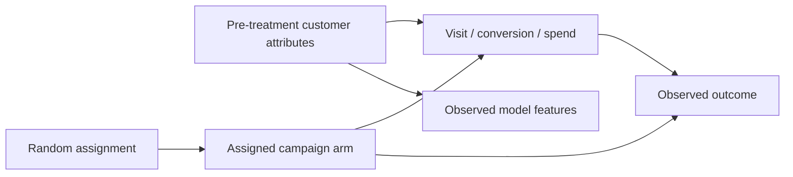

# Causal AI — Customer Growth & Revenue Optimization

A **data-science research project** using the Kevin Hillstrom / MineThatData randomized email experiment. The project moves from randomized experiment analysis to heterogeneous treatment-effect modelling, holdout policy evaluation, and budget-scenario sensitivity analysis.

The deliverable is a six-page **Streamlit research dashboard**. It is intentionally Python- and statistics-focused: no separate API service or frontend framework is required.

**Decision-maker brief:** [Email experiment decision brief](docs/DECISION_BRIEF.md) — surfaces the positive randomized average effect while keeping the unproven uplift targeting policy separate.

> **Research conclusion:** Email has a positive average effect in this experiment. The current customer-level uplift model has weak outcome prediction (holdout spend R² is close to zero), and its targeting policy has **not demonstrated superiority** to emailing everyone. Individual scores and budget allocations are exploratory analyses, not validated causal effects or production recommendations.

## Research questions

1. What is the average effect of the pooled email treatment on visits, conversion, and spend?
2. How do the two email creatives compare with the no-email control?
3. Can pre-treatment customer attributes predict expected spend under each treatment condition?
4. Does model-based targeting improve on simple policies when evaluated on a randomized holdout?
5. How sensitive is a budget allocation scenario to contact cost and contribution-margin assumptions?

## Dashboard

| Page | Data-science purpose |
|---|---|
| Executive Overview | Cohort profile, randomized-arm outcomes, average treatment effects |
| Customer Intelligence | Pre-treatment covariates and model-implied potential outcomes |
| Experimentation Lab | Two-proportion inference, Welch's t-test, confidence intervals |
| Uplift Intelligence | Two-part T-learner, holdout IPW policy values, Qini-style diagnostic |
| Budget Scenario Optimizer | Sensitivity to assumed contact cost, contribution margin, and budget |
| AI Business Reports | Groq-generated executive narrative from aggregate experiment and holdout metrics; Markdown download |

## Dataset

- **Source:** Kevin Hillstrom / MineThatData Email Analytics Challenge (2008).
- **Sample:** 64,000 randomized observations across Mens E-Mail, Womens E-Mail, and No E-Mail.
- **Treatment definition:** the primary analysis pools the two email creatives and compares the observed email mixture with no email.
- **Features:** recency, history segment, historical spend, prior mens/womens purchases, ZIP category, new-customer flag, and channel.
- **Outcomes:** visit, conversion, and spend.

The raw CSV is downloaded on first run to `data/raw/hillstrom.csv`; it is not committed to Git. The dataset has no unique customer identifier. Exact duplicate rows are retained because row equality alone does not establish duplicate customer identity. Review the upstream data terms before redistributing the dataset.

Dataset source description: https://blog.minethatdata.com/2008/03/minethatdata-e-mail-analytics-and-data.html

## Business decision and identification strategy

**Decision question:** For the historical Hillstrom audience, did assignment to either email creative (the pooled email policy) change average visit, conversion, and spend relative to no email—and does a customer-level targeting rule improve spend per eligible customer over emailing everyone?

This is an **observational analysis of a randomized experiment**, not synthetic data and not an observational-treatment study. The upstream experiment assigned customers among two email creatives and a no-email control. The main estimand is therefore the intention-to-treat effect of assignment to the pooled email mixture, not the effect of opening an email or an individual customer's latent response.

### Identification assumptions and causal diagram

The primary difference-in-means estimate relies on the experiment's documented random assignment, consistency of the assigned campaign conditions, no interference between customers, correctly observed outcomes, and treatment positivity. Pooling the two email creatives defines a mixture intervention; it does not identify the effect of either creative in isolation.



The diagram emphasizes that baseline attributes can predict outcomes but should not confound randomized assignment. The assignment mechanism supports exchangeability in expectation; finite-sample balance is assessed with standardized mean differences. The source contains no customer identifier, delivery/open events, or complete operational cost and margin data. The no-interference assumption (for example, household spillovers) cannot be empirically verified. Positivity is supported by non-zero assignment to each of the three arms; for the pooled binary contrast, the empirical treatment share is approximately two thirds.

For an observational deployment dataset, a DAG and an adjustment set would need to be specified before fitting: include only common causes measured before treatment, never adjust for mediators or variables affected by the offer, verify propensity-score overlap, and state that unobserved confounding remains possible. The current randomized dataset cannot quantify hidden-confounder bias in an observational design; that requires a separate observational identification analysis and sensitivity model.

### Baseline versus causal estimate

The observed pooled email-minus-control spend difference is **+$0.5968 per customer** (95% CI +$0.3762 to +$0.8174). Because assignment is randomized, this unadjusted difference-in-means is the design-based ATE estimator—not a misleading observational baseline. A naive correlation comparison would be misleading only if assignment were not randomized or if the analysis departed from the documented assignment mechanism.

### Estimators and scope

The project currently reports:
- Difference-in-means / Welch inference for the randomized ATE.
- A two-part T-learner for exploratory heterogeneous expected-spend predictions.
- IPW policy value and paired policy contrasts on a randomized holdout.

It does **not** currently claim that IPW, matching, doubly robust estimation, causal forests, or meta-learners beyond the T-learner have been benchmarked. Nor does it claim a validated AUUC/Qini benchmark. The Qini-style cumulative IPW curve is a ranking diagnostic. A future observational extension should compare propensity matching/IPW and a doubly robust learner against a pre-specified adjustment set, with explicit overlap and hidden-confounding sensitivity analysis.

## Statistical design

### Average treatment effects

- Binary outcomes use a two-proportion z-test with a pooled null standard error and an unpooled Wald confidence interval.
- Spend uses Welch's independent two-sample t-test and a Satterthwaite confidence interval.
- The primary estimand is email-mixture minus no-email. Creative-specific comparisons are shown separately to make treatment heterogeneity visible.
- Reported p-values are unadjusted; exploratory subgroup comparisons should not be interpreted as confirmatory tests.

### Heterogeneous treatment-effect model

A two-part T-learner is fitted separately in the pooled-email and no-email groups:

1. Logistic regression estimates conversion probability under each treatment condition.
2. Regularized gradient-boosting regressors estimate positive spend conditional on conversion.
3. Expected spend is estimated as (P(\text{conversion}) \times E(\text{spend}\mid\text{conversion})).
4. Model-implied uplift is expected spend with email minus expected spend without email.

Only pre-treatment covariates are used. Outcomes are not used as model features.

### Holdout policy evaluation

- A stratified 75/25 train/holdout split is used.
- The targeting threshold is selected using training data.
- Policy values are estimated on the randomized holdout using inverse-propensity weighting (IPW), with the known 2/3 pooled-email assignment probability.
- The model policy is compared with emailing everyone and emailing nobody. The paired policy contrast and confidence interval are reported. A seeded permutation diagnostic and baseline standardized-mean-difference balance utility are included in `src/causal_ai/statistics.py`; these are diagnostics, not proof of randomization or absence of confounding.
- Qini/AUUC is presented as an exploratory ranking diagnostic, not as evidence of profitability.

### Budget scenario

The scenario calculation is:

```text
modelled net contribution
  = estimated incremental revenue × assumed contribution margin
    − assumed email contact cost
```

The dataset contains neither delivery costs nor product contribution margins. These inputs are user assumptions. Equal contact costs make the ranking optimal for the stated point estimates, but **do not make the model's causal estimates valid**.

## Evaluation snapshot

The reproducible analysis is documented in [the full evaluation report](reports/full_evaluation.md). Model purpose, intended use, evaluation, and limitations are summarized in the [model card](reports/model_card.md) and the [identification and limitations note](reports/IDENTIFICATION_AND_LIMITATIONS.md).

| Holdout policy | IPW estimated spend per customer |
|---|---:|
| Model policy | $1.127 |
| Email everyone | $1.310 |
| Email nobody | $0.671 |

The paired model-policy minus email-everyone estimate is **−$0.183 per customer** (95% CI: −$0.444 to +$0.077). The interval includes zero. This experiment does not establish that the model policy is better or worse than emailing everyone.

Holdout spend R² is approximately 0.002 for control and 0.0002 for treatment. The model explains very little individual spend variation. Customer-level uplift scores must therefore remain exploratory.

## Reproducibility and setup

Python 3.10+ (Python 3.12 recommended).

```bash
python -m venv .venv

# Windows PowerShell
.venv\Scripts\Activate.ps1

# macOS / Linux / WSL
source .venv/bin/activate

pip install -r requirements.txt
python scripts/run_pipeline.py
streamlit run app.py
```

On first launch, the app downloads the dataset if it is not present. Run the modelling pipeline once to generate `artifacts/uplift_model.joblib` and evaluation metrics. Streamlit Community Cloud can run the pipeline from the dashboard using **Train causal models now** when artifacts are absent.

## Groq-powered AI Business Reports

The **AI Business Reports** page uses Groq Chat Completions to turn verified aggregate experiment results into an executive Markdown report. Python remains the source of truth; Groq writes the narrative only. The request includes aggregate treatment effects, confidence intervals, p-values, holdout policy values, and model diagnostics. It does **not** send raw customer rows or customer-level scores.

Add the following in Streamlit Community Cloud → **App settings → Secrets** (never commit a real key):

```toml
GROQ_API_KEY = "your_groq_api_key"
# Optional model override
GROQ_MODEL = "openai/gpt-oss-120b"
```

The report can be downloaded as Markdown. Interactive conversion, spend, and holdout-policy charts are rendered separately from verified Python aggregates; the LLM does not generate or invent chart values. Generated text is decision support, not a replacement for checking the statistical results. See the [Groq quickstart](https://console.groq.com/docs/quickstart) and [text generation documentation](https://console.groq.com/docs/text-chat).

## Deploy the dashboard

The project is designed for **Streamlit Community Cloud**; no separate backend service is required.

1. Push the repository to GitHub.
2. Create an app at https://share.streamlit.io/.
3. Select this repository, the `main` branch, and `app.py` as the main file.
4. Deploy. The runtime installs only the packages in `requirements.txt`.
5. Before the first app launch, open GitHub → **Actions** → **Train and persist uplift model** → **Run workflow**. This one-time manual workflow downloads the public Hillstrom dataset, trains the model in Python 3.12, and commits the reusable model, evaluation metrics, and training manifest to `artifacts/`.
6. Streamlit loads the saved `artifacts/uplift_model.joblib` and `artifacts/metrics.json` at runtime. **The dashboard never trains the model.** Retrain only when you intentionally change the model, features, data, or training procedure; run the workflow again to replace the saved artifacts.

The raw dataset remains downloaded at runtime rather than committed. The serialized model and metrics are versioned in GitHub, so Streamlit restarts do not require model retraining. The scikit-learn version is pinned to keep the training and serving environments compatible.

To refresh the model intentionally, rerun the **Train and persist uplift model** workflow from the Actions tab. It also writes `artifacts/model_manifest.json` with the training timestamp, source commit, package versions, and SHA-256 checksums for the dataset and model.

## Streamlit Community Cloud availability

Community Cloud currently hibernates apps after 12 hours without traffic (not 30 minutes). The scheduled keep-warm workflow has been disabled because repeated browser checks were timing out while waiting for page-specific text and did not provide a reliable uptime signal. A manual-only health check remains available under GitHub Actions → **Manual Streamlit demo health check**. Streamlit Community Cloud hibernation is a hosting limitation; this repository does not claim guaranteed uptime.

## Uplift learner research benchmark

A separate, reproducible modelling benchmark is available without changing the deployed Streamlit inference path:

```bash
pip install -e . --no-deps
python scripts/run_uplift_benchmark.py --outcome conversion --seeds 11,23,37,53,71 --folds 3
```

The runner compares S-, T-, X- and doubly robust learners using repeated out-of-fold predictions. It benchmarks equal-contact-budget policies against random targeting, recency, historical spend, prior Mens/Womens purchase indicators, email-everyone and email-nobody. It also evaluates separate Mens-vs-control and Womens-vs-control randomized contrasts. These creative-specific comparisons are not a joint three-action policy and do not by themselves establish which creative is superior.

The supported outcomes are conversion, visit and spend. Conversion and visit are binary outcomes; spend is continuous and highly zero-inflated. Use the binary outcomes as important sensitivity analyses rather than assuming spend is the only business objective. The DR learner uses the known randomized propensity and cross-fitted outcome nuisance predictions; it is not an observational propensity model. The implementation is a lightweight sklearn DR learner, not EconML's DRLearner or a causal forest.

The report records estimates across seeds. Across-seed standard deviation measures sensitivity to fold assignments; it is **not** a confidence interval from independent experiments. Policy-value intervals within each repeat use the randomized IPW estimator. The benchmark must be run on the full dataset and reviewed before quoting any new performance claim. No benchmark result is asserted here until the runner has been executed and inspected.

## Tests and quality checks

```bash
pip install -r requirements-dev.txt
pip install -e . --no-deps
pytest -q -m "not benchmark"
python -m compileall -q app.py src scripts tests
```

Runtime dependencies stay in `requirements.txt`; test tooling is isolated in `requirements-dev.txt`. GitHub Actions installs the development requirements and the local `src/` package, compiles the Python modules, runs fast tests with `pytest -m "not benchmark"`, and checks dependency consistency. The full 64,000-row benchmark runs separately through the manually dispatchable **Uplift Full Experiment** workflow and publishes one JSON artifact per outcome.

## Repository structure

```text
app.py                       Streamlit research dashboard
src/causal_ai/data.py        Dataset loading and validation
src/causal_ai/statistics.py  A/B test estimators and inference
src/causal_ai/modeling.py    T-learner, diagnostics, IPW evaluation
src/causal_ai/optimization.py
                             Budget scenario arithmetic
src/causal_ai/pipeline.py    Reproducible analysis pipeline
scripts/run_pipeline.py     One-command model training
reports/                     Evaluation report and data profile
tests/                       Statistical and modelling tests
configs/                      Reproducible analysis assumptions
```

## Assumptions, interpretation and limitations

- Treatment is the assigned email mixture (intention-to-treat), not email opening or engagement.
- Consistency and no interference are assumed; household or social spillovers are not measured.
- Assignment probabilities are known from the 1:1:1 three-arm design; the pooled email probability is 2/3 and control is 1/3.
- The pooled contrast has positivity because both assignment groups are represented. The observational propensity-overlap condition is not applicable to this randomized design; it must be checked separately for any non-randomized extension.
- Baseline balance is a diagnostic, not proof of randomization. Imbalance can occur by chance.
- No unmeasured-confounding sensitivity claim is made: randomization is the identification basis here. For observational extensions, unmeasured confounding remains an explicit threat.
- Do not adjust for post-assignment mediators such as email opens, clicks, visits, or conversion when estimating the total assignment effect.
- Customer-level CATE predictions are not individually identifiable; the T-learner approximates conditional response differences and has weak spend prediction.
- The optimizer uses assumed contact cost and contribution margin; its outputs are scenarios, not realized ROI.

## Limitations and next research steps

- Estimate creative-specific treatment effects rather than relying only on a pooled treatment.
- Repeat the train/holdout evaluation across random seeds and report uncertainty across splits.
- Compare uplift ranking with random, recency-based, and history-based baselines.
- Evaluate subgroup calibration and policy-value stability.
- Conduct a new randomized policy experiment before using customer-level targeting operationally.
- Add pre-specified sensitivity analyses and multiplicity control for confirmatory subgroup work.

## Scope

This repository is an educational and analytical research project. It is not a live marketing automation system, a causal-effect oracle, or a validated profit forecasting product.
