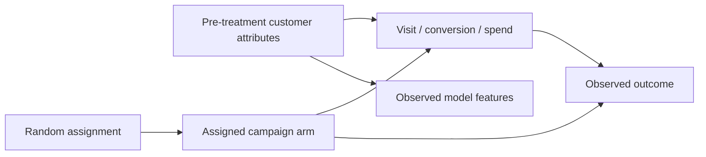

# Causal AI — Customer Growth & Revenue Optimization

A **data-science research project** using the Kevin Hillstrom / MineThatData randomized email experiment. The project moves from randomized experiment analysis to heterogeneous treatment-effect modelling, holdout policy evaluation, and budget-scenario sensitivity analysis.

The deliverable is a six-page **Streamlit research dashboard**. It is intentionally Python- and statistics-focused: no separate API service or frontend framework is required.

**Decision-maker brief:** [Email experiment decision brief](docs/DECISION_BRIEF.md) — surfaces the positive randomized average effect while keeping the unproven uplift targeting policy separate.

> **Research conclusion:** Email has a positive average effect in this experiment. The current customer-level uplift model has weak outcome prediction (holdout spend R² is close to zero), and its targeting policy has **not demonstrated superiority** to emailing everyone. Individual scores and budget allocations are exploratory analyses, not validated causal effects or production recommendations.

## Research questions

1. What is the average effect of the pooled email treatment on visits, conversion, and spend?
2. How do the two email creatives compare with the no-email control?
3. Can pre-treatment customer attributes predict expected spend under each treatment condition?
4. Does model-based targeting improve on simple policies when evaluated on a randomized holdout?
5. How sensitive is a budget allocation scenario to contact cost and contribution-margin assumptions?

## Dashboard

| Page | Data-science purpose |
|---|---|
| Executive Overview | Cohort profile, randomized-arm outcomes, average treatment effects |
| Customer Intelligence | Pre-treatment covariates and model-implied potential outcomes |
| Experimentation Lab | Two-proportion inference, Welch's t-test, confidence intervals |
| Uplift Intelligence | Two-part T-learner, randomized-holdout IPW policy values, exploratory Qini-style diagnostic |
| Robustness Evaluation | Repeated stratified splits, policy-value dispersion, paired policy contrasts and targeting-share stability |
| Uplift Benchmark Lab | T-/S-/X-learners, random/recency/history ranking baselines, HT Qini/AUUC, paired bootstrap policy contrasts |
| Multi-treatment Experiment | Mens E-Mail vs Womens E-Mail vs No E-Mail average effects and creative-specific targeting policies |
| Budget Scenario Optimizer | Sensitivity to assumed contact cost, contribution margin, and budget |
| AI Business Reports | Groq-generated executive narrative from aggregate experiment and holdout metrics; Markdown download |

## Dataset

- **Source:** Kevin Hillstrom / MineThatData Email Analytics Challenge (2008).
- **Sample:** 64,000 randomized observations across Mens E-Mail, Womens E-Mail, and No E-Mail.
- **Treatment definition:** the primary analysis pools the two email creatives and compares the observed email mixture with no email.
- **Features:** recency, history segment, historical spend, prior mens/womens purchases, ZIP category, new-customer flag, and channel.
- **Outcomes:** visit, conversion, and spend.

The raw CSV is downloaded on first run to `data/raw/hillstrom.csv`; it is not committed to Git. The dataset has no unique customer identifier. Exact duplicate rows are retained because row equality alone does not establish duplicate customer identity. Review the upstream data terms before redistributing the dataset.

Dataset source description: https://blog.minethatdata.com/2008/03/minethatdata-e-mail-analytics-and-data.html

## Business decision and identification strategy

**Decision question:** For the historical Hillstrom audience, did assignment to either email creative (the pooled email policy) change average visit, conversion, and spend relative to no email—and does a customer-level targeting rule improve spend per eligible customer over emailing everyone?

This is an **observational analysis of a randomized experiment**, not synthetic data and not an observational-treatment study. The upstream experiment assigned customers among two email creatives and a no-email control. The main estimand is therefore the intention-to-treat effect of assignment to the pooled email mixture, not the effect of opening an email or an individual customer's latent response.

### Identification assumptions and causal diagram

The primary difference-in-means estimate relies on the experiment's documented random assignment, consistency of the assigned campaign conditions, no interference between customers, correctly observed outcomes, and treatment positivity. Pooling the two email creatives defines a mixture intervention; it does not identify the effect of either creative in isolation.



The diagram emphasizes that baseline attributes can predict outcomes but should not confound randomized assignment. The assignment mechanism supports exchangeability in expectation; finite-sample balance is assessed with standardized mean differences. The source contains no customer identifier, delivery/open events, or complete operational cost and margin data. The no-interference assumption (for example, household spillovers) cannot be empirically verified. Positivity is supported by non-zero assignment to each of the three arms; for the pooled binary contrast, the empirical treatment share is approximately two thirds.

For an observational deployment dataset, a DAG and an adjustment set would need to be specified before fitting: include only common causes measured before treatment, never adjust for mediators or variables affected by the offer, verify propensity-score overlap, and state that unobserved confounding remains possible. The current randomized dataset cannot quantify hidden-confounder bias in an observational design; that requires a separate observational identification analysis and sensitivity model.

### Baseline versus causal estimate

The observed pooled email-minus-control spend difference is **+$0.5968 per customer** (95% CI +$0.3762 to +$0.8174). Because assignment is randomized, this unadjusted difference-in-means is the design-based ATE estimator—not a misleading observational baseline. A naive correlation comparison would be misleading only if assignment were not randomized or if the analysis departed from the documented assignment mechanism.

### Estimators and scope

The project currently reports:
- Difference-in-means / Welch inference for the randomized ATE.
- A two-part T-learner for exploratory heterogeneous expected-spend predictions.
- IPW policy value and paired policy contrasts on a randomized holdout.

It does **not** currently claim that IPW, matching, doubly robust estimation, causal forests, or meta-learners beyond the T-learner have been benchmarked. Nor does it claim a validated AUUC/Qini benchmark. The Qini-style cumulative IPW curve is a ranking diagnostic. A future observational extension should compare propensity matching/IPW and a doubly robust learner against a pre-specified adjustment set, with explicit overlap and hidden-confounding sensitivity analysis.

## Statistical design

### Average treatment effects

- Binary outcomes use a two-proportion z-test with a pooled null standard error and an unpooled Wald confidence interval.
- Spend uses Welch's independent two-sample t-test and a Satterthwaite confidence interval.
- The primary estimand is email-mixture minus no-email. Creative-specific comparisons are shown separately to make treatment heterogeneity visible.
- Reported p-values are unadjusted; exploratory subgroup comparisons should not be interpreted as confirmatory tests.

### Heterogeneous treatment-effect model

A two-part T-learner is fitted separately in the pooled-email and no-email groups:

1. Logistic regression estimates conversion probability under each treatment condition.
2. Regularized gradient-boosting regressors estimate positive spend conditional on conversion.
3. Expected spend is estimated as (P(\text{conversion}) \times E(\text{spend}\mid\text{conversion})).
4. Model-implied uplift is expected spend with email minus expected spend without email.

Only pre-treatment covariates are used. Outcomes are not used as model features.

### Holdout policy evaluation

- A stratified 75/25 train/holdout split is used.
- The targeting threshold is selected using training data.
- Policy values are estimated on the randomized holdout using inverse-propensity weighting (IPW), with the known 2/3 pooled-email assignment probability.
- The model policy is compared with emailing everyone and emailing nobody. The paired policy contrast and confidence interval are reported. A seeded permutation diagnostic and baseline standardized-mean-difference balance utility are included in `src/causal_ai/statistics.py`; these are diagnostics, not proof of randomization or absence of confounding.
- Qini/AUUC is presented as an exploratory ranking diagnostic, not as evidence of profitability.

### Budget scenario

The scenario calculation is:

```text
modelled net contribution
  = estimated incremental revenue × assumed contribution margin
    − assumed email contact cost
```

The dataset contains neither delivery costs nor product contribution margins. These inputs are user assumptions. Equal contact costs make the ranking optimal for the stated point estimates, but **do not make the model's causal estimates valid**.

## Evaluation snapshot

The reproducible analysis is documented in [the full evaluation report](reports/full_evaluation.md). Model purpose, intended use, evaluation, and limitations are summarized in the [model card](reports/model_card.md) and the [identification and limitations note](reports/IDENTIFICATION_AND_LIMITATIONS.md).

| Holdout policy | IPW estimated spend per customer |
|---|---:|
| Model policy | $1.127 |
| Email everyone | $1.310 |
| Email nobody | $0.671 |

The paired model-policy minus email-everyone estimate is **−$0.183 per customer** (95% CI: −$0.444 to +$0.077). The interval includes zero. This experiment does not establish that the model policy is better or worse than emailing everyone.

Holdout spend R² is approximately 0.002 for control and 0.0002 for treatment. The model explains very little individual spend variation. Customer-level uplift scores must therefore remain exploratory.

## Reproducibility and setup

Python 3.10+ (Python 3.12 recommended).

```bash
python -m venv .venv

# Windows PowerShell
.venv\Scripts\Activate.ps1

# macOS / Linux / WSL
source .venv/bin/activate

pip install -r requirements.txt
python scripts/run_pipeline.py
streamlit run app.py
```

On first launch, the app downloads the dataset if it is not present. Run the modelling pipeline once to generate `artifacts/uplift_model.joblib` and evaluation metrics. Streamlit Community Cloud can run the pipeline from the dashboard using **Train causal models now** when artifacts are absent.

## Groq-powered AI Business Reports

The **AI Business Reports** page uses Groq Chat Completions to turn verified aggregate experiment results into an executive Markdown report. Python remains the source of truth; Groq writes the narrative only. The request includes aggregate treatment effects, confidence intervals, p-values, holdout policy values, and model diagnostics. It does **not** send raw customer rows or customer-level scores.

Add the following in Streamlit Community Cloud → **App settings → Secrets** (never commit a real key):

```toml
GROQ_API_KEY = "your_groq_api_key"
# Optional model override
GROQ_MODEL = "openai/gpt-oss-120b"
```

The report can be downloaded as Markdown. Interactive conversion, spend, and holdout-policy charts are rendered separately from verified Python aggregates; the LLM does not generate or invent chart values. Generated text is decision support, not a replacement for checking the statistical results. See the [Groq quickstart](https://console.groq.com/docs/quickstart) and [text generation documentation](https://console.groq.com/docs/text-chat).

## Deploy the dashboard

The project is designed for **Streamlit Community Cloud**; no separate backend service is required.

1. Push the repository to GitHub.
2. Create an app at https://share.streamlit.io/.
3. Select this repository, the `main` branch, and `app.py` as the main file.
4. Deploy. The runtime installs only the packages in `requirements.txt`.
5. Before the first app launch, open GitHub → **Actions** → **Train and persist uplift model** → **Run workflow**. This one-time manual workflow downloads the public Hillstrom dataset, trains the model in Python 3.12, and commits the reusable model, evaluation metrics, and training manifest to `artifacts/`.
6. Streamlit loads the saved `artifacts/uplift_model.joblib` and `artifacts/metrics.json` at runtime. **The dashboard never trains the model.** Retrain only when you intentionally change the model, features, data, or training procedure; run the workflow again to replace the saved artifacts.

The raw dataset remains downloaded at runtime rather than committed. The serialized model and metrics are versioned in GitHub, so Streamlit restarts do not require model retraining. The scikit-learn version is pinned to keep the training and serving environments compatible.

To refresh the model intentionally, rerun the **Train and persist uplift model** workflow from the Actions tab. It also writes `artifacts/model_manifest.json` with the training timestamp, source commit, package versions, and SHA-256 checksums for the dataset and model.

## Streamlit Community Cloud availability

Community Cloud currently hibernates apps after 12 hours without traffic (not 30 minutes). The **Keep Streamlit demo warm** GitHub Actions workflow opens the public app in a headless browser every 4 hours and clicks the app's wake-up control if the hibernation page appears. This is best-effort only: GitHub scheduled workflows can be delayed or skipped during periods of high load, and this does not provide an uptime guarantee. Scheduled workflows run from the default branch; GitHub may automatically disable scheduled workflows in public repositories after 60 days without repository activity.

## Tests and quality checks

```bash
pip install -r requirements-dev.txt
pytest -q
python -m compileall -q app.py src scripts tests
```

Runtime dependencies stay in `requirements.txt`; test tooling is isolated in `requirements-dev.txt`. GitHub Actions installs the development requirements, compiles the Python modules, runs the automated unit tests, and checks dependency consistency. The full 64,000-row model pipeline is kept out of CI to keep checks fast and deterministic.

## Repository structure

```text
app.py                       Streamlit research dashboard
src/causal_ai/data.py        Dataset loading and validation
src/causal_ai/statistics.py  A/B test estimators and inference
src/causal_ai/modeling.py    T-learner, diagnostics, IPW evaluation
src/causal_ai/benchmarking.py Meta-learners, ranking baselines, bootstrap, 3-arm analysis
src/causal_ai/optimization.py
                             Budget scenario arithmetic
src/causal_ai/pipeline.py    Reproducible analysis pipeline
scripts/run_pipeline.py     One-command model training
scripts/run_uplift_benchmark.py
                             Meta-learner and creative benchmark runner
reports/                     Evaluation report and data profile
tests/                       Statistical and modelling tests
configs/                      Reproducible analysis assumptions
```

## Assumptions, interpretation and limitations

- Treatment is the assigned email mixture (intention-to-treat), not email opening or engagement.
- Consistency and no interference are assumed; household or social spillovers are not measured.
- Assignment probabilities are known from the 1:1:1 three-arm design; the pooled email probability is 2/3 and control is 1/3.
- The pooled contrast has positivity because both assignment groups are represented. The observational propensity-overlap condition is not applicable to this randomized design; it must be checked separately for any non-randomized extension.
- Baseline balance is a diagnostic, not proof of randomization. Imbalance can occur by chance.
- No unmeasured-confounding sensitivity claim is made: randomization is the identification basis here. For observational extensions, unmeasured confounding remains an explicit threat.
- Do not adjust for post-assignment mediators such as email opens, clicks, visits, or conversion when estimating the total assignment effect.
- Customer-level CATE predictions are not individually identifiable; the T-learner approximates conditional response differences and has weak spend prediction.
- The optimizer uses assumed contact cost and contribution margin; its outputs are scenarios, not realized ROI.

## Why the average treatment effect can be positive while uplift targeting is weak

These are different statistical questions.

**The average treatment effect (ATE)** compares mean outcomes under the randomized email mixture and no-email control. Random assignment makes the difference in group means a design-based estimate of the average effect for this experiment, subject to the documented assignment, consistency, outcome-measurement and no-interference assumptions. The observed pooled spend difference is +$0.5968 per assigned customer (95% CI +$0.3762 to +$0.8174).

**Individualized uplift ranking** asks a harder question: can pre-treatment characteristics reliably distinguish which customers benefit more from email? The individual treatment effect for a person is never observed because that person receives only one assignment. A T-learner approximates conditional mean outcomes by fitting separate response models in the two assignment groups, then subtracts the predictions. Noise in either model is carried into the difference; sparse conversions and highly zero-inflated spend make that especially difficult.

Therefore, a positive ATE does not imply that a targeting model can identify the best recipients. Emailing everyone can be beneficial on average even when the model cannot rank heterogeneous effects accurately. In this evaluation the model-policy IPW estimate is about $1.127 per customer, compared with $1.310 for emailing everyone. The paired model-minus-email-everyone estimate is −$0.183 (95% CI −$0.444 to +$0.077), so superiority has not been demonstrated.

**Decision implication:** the experiment supports an average email effect for this historical audience; it does not support deploying the current customer-level scores or claiming that targeted allocation increases profit.

## Repeated-split robustness diagnostic

The repository now includes an optional repeated-split evaluation. It refits the same two-part T-learner across multiple seeded stratified partitions and reports split-to-split variation in model-policy value, email-everyone and email-nobody policy values, model-minus-email-everyone contrasts, targeting share, and exploratory Qini/AUUC diagnostics.

Run after downloading the raw dataset:

```bash
python scripts/run_robustness.py
```

Optional controls:

```bash
python scripts/run_robustness.py --seeds 11,23,37,51,73 --test-size 0.25 --threshold 0.05
```

The output is written to `reports/repeated_split_robustness.json`. These are repeated partitions of the **same 64,000-row historical dataset**, not independent replications or external validation. The repeated-split report is a sensitivity diagnostic; it must not be used to choose a final model and then be described as an untouched confirmation. The primary evidence remains the frozen evaluation in [reports/full_evaluation.md](reports/full_evaluation.md).

## Uplift meta-learner and multi-treatment benchmark

Run the expanded benchmark after the raw Hillstrom CSV is available:

```bash
python scripts/run_uplift_benchmark.py
```

Optional controls:

```bash
python scripts/run_uplift_benchmark.py --seed 42 --test-size 0.25 --bootstrap 1000
```

The full machine-readable report is written to `reports/uplift_benchmark.json`. The benchmark uses one stratified train/holdout partition of the same randomized experiment and compares:

| Strategy | Definition |
|---|---|
| T-learner | Separate ExtraTrees expected-spend outcome models for pooled email and control; predict the difference |
| S-learner | One expected-spend model with treatment as an input; predict each customer under both assignments |
| X-learner | Impute effects from the two outcome models, fit arm-specific effect models, and combine using known propensity |
| Random | Seeded random ranking |
| Recency | Rank lower recency values first (more recent purchase) |
| Historical spend | Rank higher pre-treatment historical spend first |

All ranking strategies target the same approximate 2/3 contact share, matching the pooled email assignment share. Policy value is estimated on the untouched holdout using the Horvitz-Thompson inverse-propensity-weighted estimator:

```text
V(policy) = mean[ I(A = policy(X)) * Y / P(A = policy(X)) ]
```

**Qini and AUUC definitions:** for each ranking, construct the Horvitz-Thompson pseudo-outcome `A*Y/e - (1-A)*Y/(1-e)`, sort customers by predicted score, and cumulatively sum the pseudo-outcome. AUUC is the trapezoidal area under that cumulative gain curve. Qini is the area between that curve and the straight-line gain expected from random ranking. These are ranking diagnostics, not profit estimates, CATE calibration scores, or proof of policy superiority. The random-ranking comparator is one seeded realization; repeat the seed to characterize its Monte Carlo variation.

**Bootstrap uncertainty:** policy contrasts use paired nonparametric resampling of holdout rows and percentile 95% intervals. The report includes each strategy versus emailing everyone and pairwise contrasts between the ranking strategies (including T-vs-S, T-vs-X, and learner-vs-baseline comparisons). The intervals condition on fitted models and do not include uncertainty from training, model selection, or repeated dataset collection. They should not be interpreted as a prospective deployment guarantee.

### Three-arm creative analysis

The multi-treatment extension preserves the randomized `No E-Mail`, `Mens E-Mail`, and `Womens E-Mail` arms. It reports observed spend differences with Welch confidence intervals for:

- Mens E-Mail versus No E-Mail.
- Womens E-Mail versus No E-Mail.
- Mens E-Mail versus Womens E-Mail.

A separate three-arm outcome-model T-learner predicts expected spend under each creative and calculates model-implied pairwise effects. Creative-specific targeting policies are evaluated against control within each two-arm subset, using the known 1/2 conditional assignment probability and a 50% contact share.

The observed arm-level contrasts are randomized average effects. The model-implied customer-level contrasts are exploratory and are not individually observed. The benchmark does not claim that one creative is universally optimal or that the targeting policies are profitable.

## Limitations and next research steps

- Estimate creative-specific treatment effects rather than relying only on a pooled treatment.
- Repeat the train/holdout evaluation across random seeds and report uncertainty across splits.
- Compare uplift ranking with random, recency-based, and history-based baselines.
- Evaluate subgroup calibration and policy-value stability.
- Conduct a new randomized policy experiment before using customer-level targeting operationally.
- Add pre-specified sensitivity analyses and multiplicity control for confirmatory subgroup work.

## Scope

This repository is an educational and analytical research project. It is not a live marketing automation system, a causal-effect oracle, or a validated profit forecasting product.
