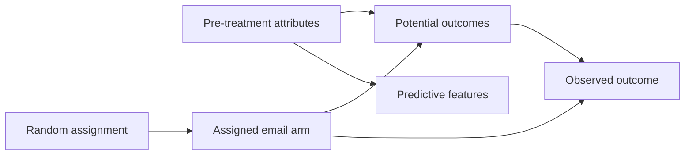

# Identification, validation and limitations note

## Project and decision

This project analyzes the public Kevin Hillstrom / MineThatData 2008 email-marketing randomized experiment. The decision question is whether assignment to the mixture of two email creatives changes average customer visits, conversion and spend versus no email, and whether a model-based targeting rule improves policy value over emailing everyone.

The data are real historical experimental observations. They are not synthetic, so there is no known individual treatment-effect ground truth against which to claim recovery accuracy.

## Target estimand

The primary estimand is the intention-to-treat average effect of assignment to either email creative (pooled) versus no email. Pooling two creatives creates a mixture policy. It does not identify the isolated effect of either creative, an email open, or an individual customer's counterfactual response.

## Identification assumptions

1. **Random assignment / exchangeability:** assignment is independent of potential outcomes under the original experiment mechanism.
2. **Consistency:** observed outcomes correspond to the assigned campaign condition; the pooled treatment is interpreted as the experiment's observed mixture of creatives.
3. **Positivity:** the three original arms each have non-zero assignment probability; pooled email probability is 2/3 and no-email probability is 1/3.
4. **No interference:** one customer's assignment does not change another customer's outcome. The data do not measure household or social spillovers, so this remains an assumption.
5. **Outcome measurement:** spend, conversion and visit are accurately recorded for the observation window.
6. **Pre-treatment covariates only for prediction:** recency, historic spend, prior purchases, ZIP category, new-customer status and channel precede assignment. Opens, clicks, visits and conversion are post-assignment and must not be used as adjustment controls for the total assignment effect.

The simplified causal structure is:

In this randomized design, a DAG-based confounder adjustment is not what identifies the primary ATE. The observed unadjusted difference-in-means is the design-based estimator. Baseline standardized mean differences are useful diagnostics but cannot prove that assignment was randomized.

## Reported evidence

The repository's reproducible evaluation report currently records:
- Pooled-email minus no-email spend difference: **+$0.5968 per customer**, 95% CI **[+$0.3762, +$0.8174]**.
- Conversion difference: **+0.495 percentage points**, 95% CI **[+0.355, +0.636] pp**.
- Visit difference: **+6.088 percentage points**, 95% CI **[+5.544, +6.633] pp**.
- Holdout policy IPW spend value: model **$1.127**, email everyone **$1.310**, email nobody **$0.671** per customer.
- Paired model-policy minus email-everyone contrast: **−$0.183**, 95% CI **[−$0.444, +$0.077]**.
- Holdout spend R² is near zero for both treatment arms.

The historical result supports a positive average response to the pooled email assignment. It does **not** establish that the uplift policy is superior or that scenario net contribution is realized profit.

## Estimators actually implemented

- Welch difference-in-means for continuous spend, including a confidence interval.
- Two-proportion inference for binary outcomes.
- Two-part T-learner for model-implied conditional expected spend under each treatment.
- IPW policy-value estimator and paired IPW comparison on a randomized holdout.
- IPW cumulative gain / Qini-style curve, explicitly treated as an exploratory ranking diagnostic.

The code does not currently implement propensity-score matching, a doubly robust learner, causal forest, or a benchmark suite of S/T/X/DR learners. Do not imply otherwise in the README or CV.

## Validation now available / still required

The validation utilities added on the research-validation-upgrades branch:
- Numeric and one-hot categorical standardized mean differences for baseline balance.
- A reproducible permutation diagnostic under the sharp null, using a seeded randomization distribution.

These tests are programming and design diagnostics; neither one proves randomization, no interference, correct source provenance, or a causal estimand. They do not constitute hidden-confounder sensitivity analysis.

Still required for stronger generalization claims:
- Run balance diagnostics on the original data and publish the plot/table; inspect each covariate level.
- Use a pre-specified randomization/permutation procedure matching the actual three-arm assignment, not a generic permutation that ignores strata or blocks if present.
- Repeat train/holdout evaluation over multiple seeds or use cross-fitting, keeping policy threshold selection inside training folds.
- Benchmark random, recency, history-spend and simple treatment-all policies on the same untouched randomized holdout.
- Report uncertainty for Qini/AUUC and policy-value differences, ideally with assignment-aware bootstrap/randomization intervals.
- Validate subgroup estimates with multiplicity control and adequate effective sample sizes.
- Before deployment, run a prospective randomized policy experiment and predefine outcomes, guardrails, power and stopping rules.

## Observational extension: what changes

If the treatment is not randomized in a future application, exchangeability is no longer supplied by design. The analyst must define a DAG before modeling; select only common causes measured before treatment; assess overlap/positivity using propensity-score distributions and effective sample size; compare unadjusted, matching/IPW and doubly robust estimates; and perform sensitivity analysis for plausible unmeasured confounding. Post-treatment mediators must not be adjusted for when estimating total effects. No observational estimate should be called causal merely because it uses a causal-ML package.

The current randomized Hillstrom analysis cannot quantify the effect of an unknown unmeasured confounder in a separate observational treatment process. That is a different estimand and design.

## Decision-layer limitations

The budget optimizer is an illustrative equal-cost scenario. It multiplies model-implied incremental spend by a user-entered contribution-margin fraction and subtracts a user-entered contact cost. Neither contribution margin nor delivery cost is observed in this dataset. Weak individual spend prediction and unvalidated uplift rankings mean the resulting allocations and ROI are not operational recommendations.

## Summary

The defensible portfolio story is not "AI finds the most profitable customers." It is: "I analyzed a real randomized marketing experiment, estimated a positive average treatment effect, built and evaluated a two-part uplift learner, and reported that it failed to beat the email-everyone policy on the available holdout. I then made the identification assumptions and next validation requirements explicit." This is a stronger and more credible research result than claiming unverified targeting lift.
